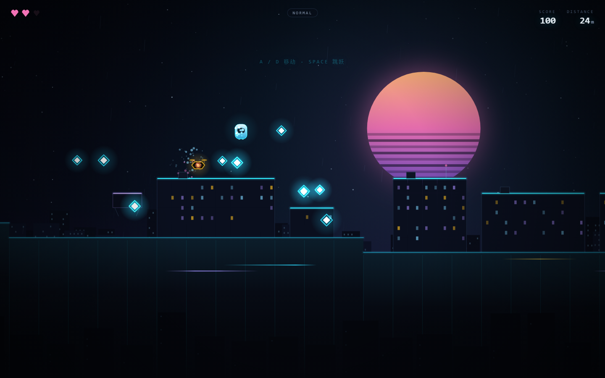

# SKYLINE RUNNER · 天际行者

A neon skyline platformer where every building is procedurally generated from a seed — and the drones are hunting you.

**▶ Play in your browser:** https://wjd0011.github.io/skyline-runner/

[](https://wjd0011.github.io/skyline-runner/)




## What makes it different

- **Procedural architecture** — buildings, canyons, stepping ledges and rooftop props are generated chunk by chunk from a seed. Same seed, same skyline; share it via `?seed=NEON42`.
- **AI enemies that react** — patrol walkers chase you across a roof, drones drift until you enter their range and then dive. Both can be stomped; both can end your run.
- **Distance-driven pressure** — the first 96 m are deliberately calm, then enemy density and speed ramp with distance instead of hitting you with a wall of robots on spawn.
- **Three difficulty modes** — Easy / Normal / Hard change hearts, spawn curve, enemy speed and score multiplier. High scores are tracked per mode.
- **Hand-tuned movement** — coyote time, jump buffering, variable jump height, air control and a 120 Hz fixed-step simulation. The jump feels right before anything else.
- **Zero dependencies** — no engine, no bundler, no build step. Canvas 2D and ES modules, served straight from GitHub Pages.

## Controls

| Action | Keyboard | Touch |
| --- | --- | --- |
| Move | `A` / `D` or `←` / `→` | ◀ ▶ |
| Jump | `Space` / `W` / `↑` | ▲ |
| Pause | `Esc` | — |
| Restart | `Enter` | — |
| Difficulty | `1` / `2` / `3` or the buttons on the title screen | same |
| New seed | click the seed on the title screen | same |

Hold jump longer to jump higher. You have three hearts — contact costs one and grants brief invulnerability.

## Difficulty

| | Hearts | Spawn curve (enemies / chunk) | Enemy speed | Score |
| --- | --- | --- | --- | --- |
| **Easy** | 4 | 0 → 1.3 | 0.82× → 0.98× | ×0.8 |
| **Normal** | 3 | 0 → 2.2 | 0.95× → 1.10× | ×1.0 |
| **Hard** | 2 | 0 → 2.9 | 1.06× → 1.26× | ×1.3 |

The first two chunks (96 m) never spawn enemies or street hazards, so every run opens with a clean runway. After that, spawn chance is lerped between the difficulty's start and end values across its ramp window (for example Normal ramps from 70 m to 600 m).

## How it works

```
src/
  main.js       bootstrap, UI state machine, input, fixed-step loop
  game.js       world streaming, collisions, scoring, camera, run lifecycle
  world.js      seeded chunk generation: ground, buildings, ledges, hazards, spawns
  player.js     movement, AABB tile collision, coyote time, jump buffering
  entities.js   walker / drone AI and collectible orbs
  render.js     parallax skyline, synthwave sun, buildings, neon, particles, post FX
  audio.js      WebAudio synth SFX (no audio files)
  rng.js        mulberry32 + hashing for deterministic generation
  config.js     physics tuning and palette
```

- **Determinism**: chunk `i` is generated from `mulberry32(seed ^ hash(i))`, so regeneration never changes a level you have already seen.
- **Streaming**: only a ±2 chunk window is kept in memory; entities are born and retired with their chunk.
- **Physics**: 120 Hz fixed timestep with accumulator, so collision behaviour is identical on 60 Hz and 144 Hz displays.
- **Feel**: gravity is increased by 2.2× while the jump key is released mid-rise, giving variable jump height without a second timer.

## Run locally

```bash
python -m http.server 8000
# open http://localhost:8000
```

No install, no build. Any static server works.

## Roadmap

- [ ] More enemy archetypes (turrets, swarmers)
- [ ] Rooftop modifiers: moving platforms, collapsing cranes
- [ ] Daily challenge seeds and a local leaderboard
- [ ] Gamepad support

## License

MIT — art, code and audio are original and generated at runtime.
